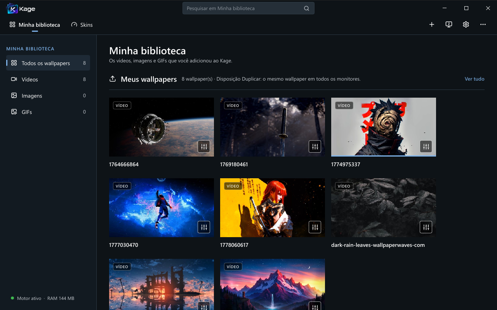
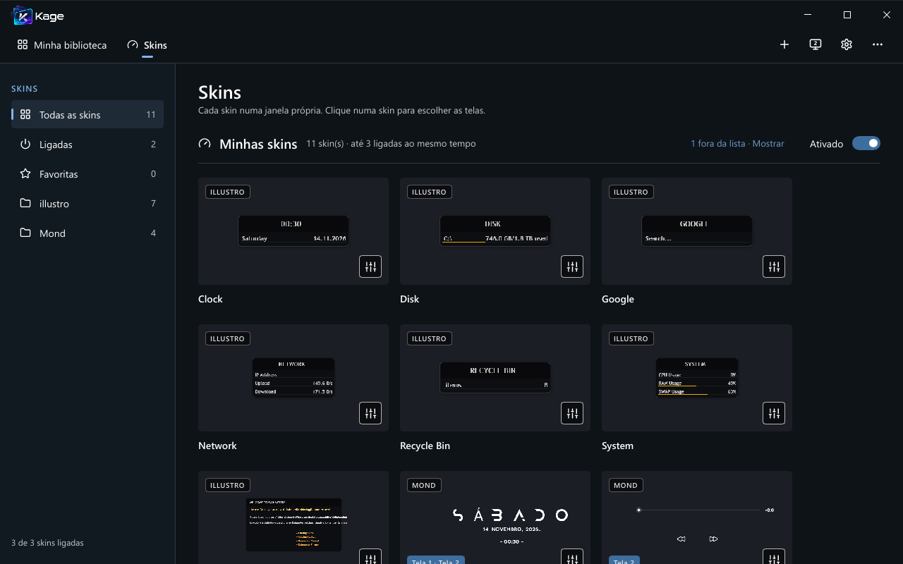
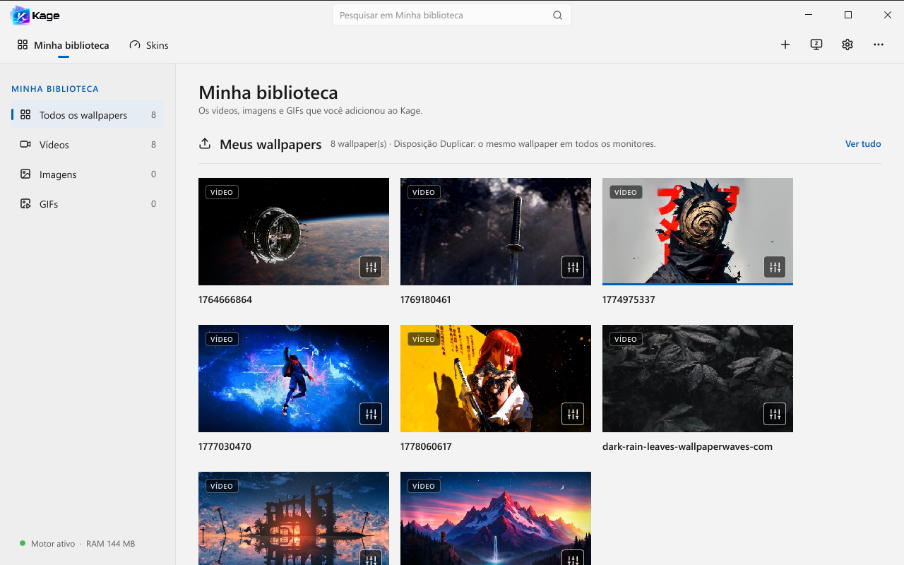
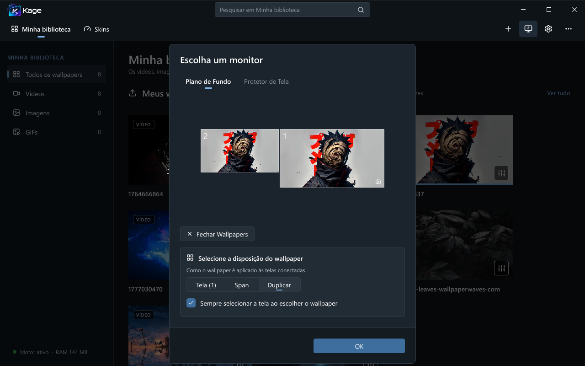
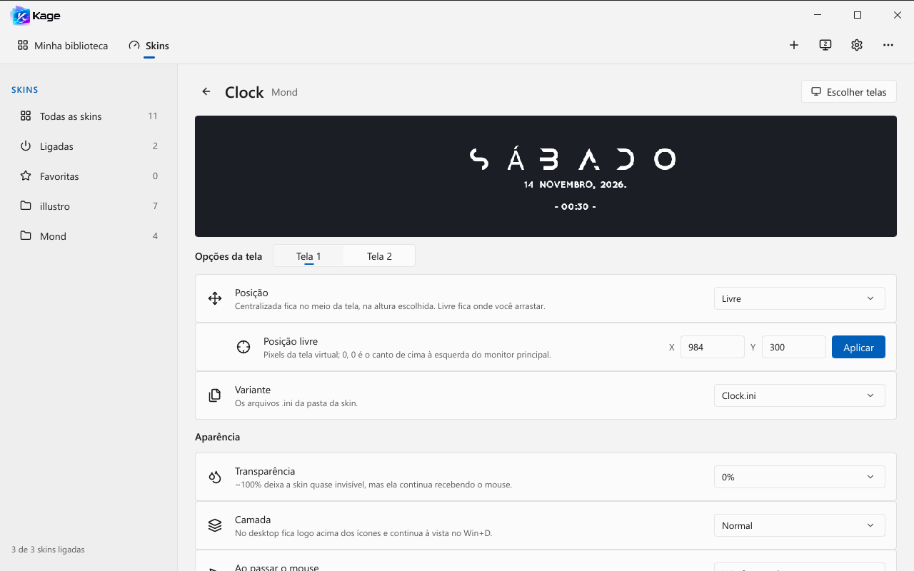
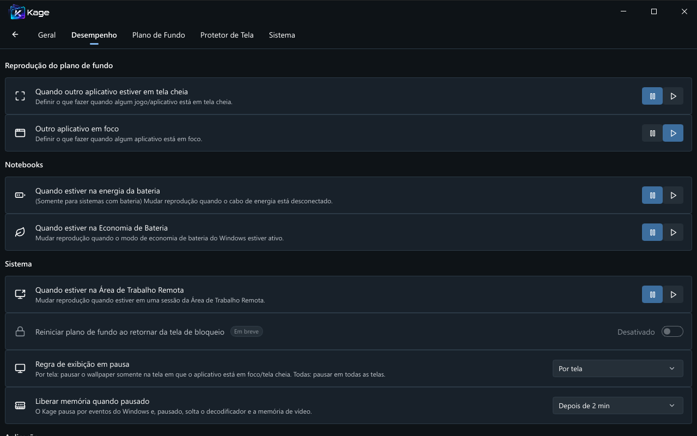
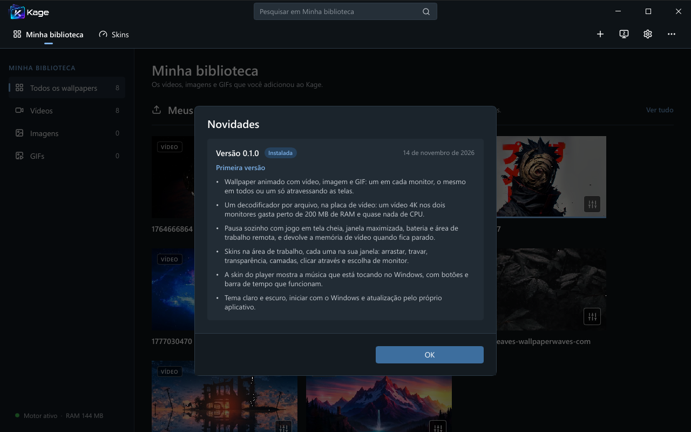
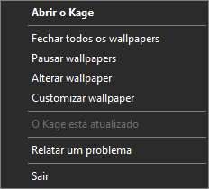
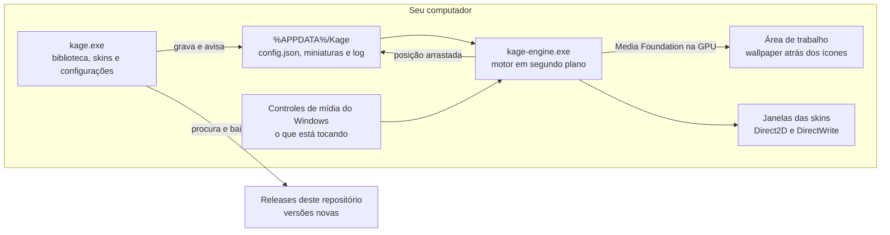
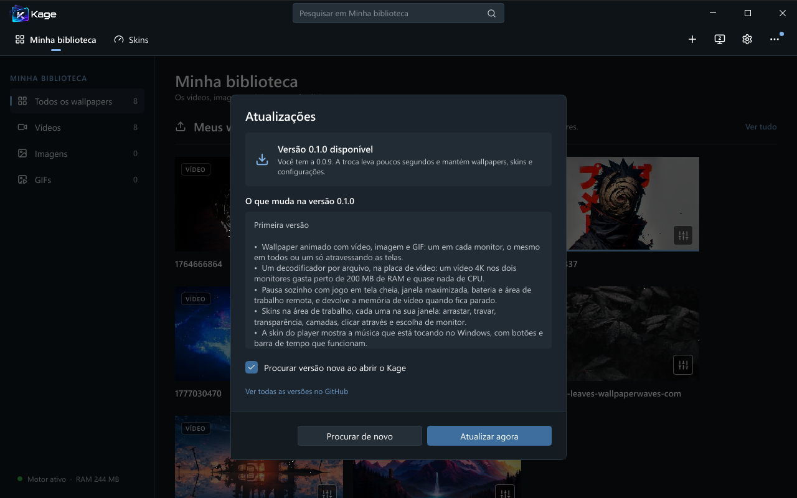

<div align="center">

<picture>
  <source media="(prefers-color-scheme: dark)" srcset="docs/imagens/logo-escuro.png" />
  
</picture>

<p>
  <strong>Wallpaper animado e skins na área de trabalho do Windows, gastando quase nada.</strong>
</p>

<p>
  App nativo para Windows, com motor em Rust, que toca vídeo, imagem e GIF atrás dos ícones da área de trabalho e desenha skins (relógio, sistema, player de música) cada uma na sua janela. Um decodificador por arquivo, na placa de vídeo; pausa sozinho quando você está em jogo ou numa janela maximizada; devolve a memória de vídeo quando fica parado.
</p>

<br/>

<p>
  
  
  
  
</p>

<br/>

<a href="https://github.com/LucasDias777/Kage/releases/latest/download/Kage.zip"></a>

<br/><br/>



<br/>

<table>
  <tr>
    <td align="center"></td>
    <td align="center"></td>
  </tr>
  <tr>
    <td align="center"><sub>Skins, cada uma com a prévia desenhada pelo próprio motor</sub></td>
    <td align="center"><sub>Tema claro, que segue o Windows ou fica fixo</sub></td>
  </tr>
</table>

</div>

---

## Sumário

- [O que o Kage faz](#o-que-o-kage-faz)
- [Skins](#skins)
- [Leveza](#leveza)
- [Como funciona](#como-funciona)
- [Tecnologias](#tecnologias)
- [Estrutura do projeto](#estrutura-do-projeto)
- [Instalação](#instalação)
- [Atualização](#atualização)
- [Desinstalação](#desinstalação)
- [Compilar a partir do código](#compilar-a-partir-do-código)
- [Licença](#licença)
- [Créditos](#créditos)

## O que o Kage faz

| Recurso | Como funciona |
|---|---|
| **Vídeo, imagem e GIF** | MP4, MKV, WebM, MOV, PNG, JPG, WebP, BMP e GIF atrás dos ícones da área de trabalho. Escolha arquivos soltos ou uma pasta inteira |
| **Vários monitores** | Um wallpaper diferente em cada tela, o mesmo em todas (Duplicar) ou um só atravessando as telas (Span), escolhido num mapa dos monitores |
| **Ajuste por wallpaper** | Velocidade, brilho, contraste e saturação, e o encaixe na tela: preencher, ajustar ou esticar |
| **Pausa inteligente** | Para quando um jogo ou app está em tela cheia, quando outra janela está em foco (se você quiser), na bateria, na economia de bateria e na área de trabalho remota. Regras por app, por tela ou em todas as telas |
| **Memória devolvida** | Pausado por alguns minutos, o motor solta o decodificador e a memória de vídeo, e volta do ponto onde parou |
| **Skins na área de trabalho** | Relógio, data, CPU, memória, disco, rede, player de música e mais, cada skin numa janela própria: arrastar, travar, transparência, camadas (sempre visível, normal, no desktop), clicar através, sumir ao passar o mouse e escolha de monitor |
| **Relógio do Kage** | Skin própria que já vem com o Kage: o dia da semana em letras largas, na fonte Kage Display (desenhada para o Kage), a data e o horário com um enfeite em volta. Numa instalação nova, aparece ligada no centro da tela principal |
| **Tocando agora** | A skin do player mostra a música que está tocando no Windows (Spotify, navegador, qualquer app com os controles de mídia do sistema), com tocar, pausar, avançar, voltar e barra de tempo clicável |
| **Janela leve** | Biblioteca, skins e configurações numa janela própria, com barra de título do Kage, tema claro e escuro e fundo personalizado. Fechada, não gasta nada: quem fica rodando é só o motor |
| **Ícone na bandeja** | Dois cliques abrem a janela. O clique direito traz Abrir o Kage, Fechar todos os wallpapers, Pausar wallpapers (o ícone fica cinza), Alterar wallpaper (sorteia outro da biblioteca), Customizar wallpaper, o estado da atualização, Relatar um problema e Sair. Dá para esconder o ícone em Configurações › Geral |
| **Inicia com o Windows** | Uma chave em Configurações › Geral; o motor abre sozinho com o seu usuário, sem permissão de administrador |
| **Atualização pelo app** | Procura versão nova nas Releases deste repositório, avisa com um balão na bandeja mesmo com a janela fechada, mostra o que muda e troca os arquivos com um clique |
| **Novidades** | Depois de cada atualização, uma tela conta o que entrou na versão |

<table>
  <tr>
    <td align="center"></td>
    <td align="center"></td>
  </tr>
  <tr>
    <td align="center"><sub>Escolha do monitor e da disposição</sub></td>
    <td align="center"><sub>Opções de uma skin, separadas por tela</sub></td>
  </tr>
  <tr>
    <td align="center"></td>
    <td align="center"></td>
  </tr>
  <tr>
    <td align="center"><sub>Regras de pausa e liberação de memória</sub></td>
    <td align="center"><sub>Novidades da versão instalada</sub></td>
  </tr>
</table>

<div align="center">
  
  <br/>
  <sub>Menu do ícone na bandeja</sub>
</div>

## Skins

O Kage lê skins no formato `.ini` usado pelo Rainmeter e desenha tudo sozinho, com Direct2D e DirectWrite: não precisa de outro programa instalado. Cada pacote fica numa pasta dentro de `Documentos\Rainmeter\Skins` (ou na pasta configurada no `Rainmeter.ini`, se existir) e aparece na aba **Skins**.

| Já funciona | Ainda não |
|---|---|
| Variáveis, `@include`, fórmulas, `MeterStyle`, variáveis de seção (`[Medida]`, `[Medida:%]`) | Scripts Lua (`Measure=Script`) |
| Medidas de tempo, cálculo, CPU, memória, disco e rede, com `Substitute` e `RegExpSubstitute` | `Measure=String`, `WebParser` e `InputText` |
| Medidores de texto, imagem, forma e barra, e a imagem de fundo da skin | Plugins em DLL de terceiros |
| Plugins de "tocando agora" (`NowPlaying` e `WebNowPlaying`), lidos dos controles de mídia do Windows | Instalar pacotes `.rmskin` (extraia a pasta manualmente) |
| Cliques, duplo clique, rodinha e as ações `SetVariable`, `SetOption`, `Show/Hide/ToggleMeter`, `CommandMeasure`, `Toggle/Activate/DeactivateConfig`, `Refresh` e abrir programas | |

Para proteger o desempenho, ficam ligadas **até 3 skins ao mesmo tempo**, somando todas as telas. Os arquivos das skins nunca são reescritos pelo Kage: posição, transparência e as outras opções ficam na configuração do próprio Kage.

### Relógio do Kage

O Kage traz uma skin própria, o **Relógio**, que ele mesmo instala em `Kage\Relógio`, dentro da pasta de skins. Cada vez que a janela abre, as fontes do Relógio voltam às do Kage, mas o arquivo `Relógio.ini` não é mexido depois de criado. Para mudar o tamanho, clique com o botão direito no Relógio, vá em **Editar skin** e troque a `Escala` e o `EspacoDia` juntos: `1.30` e `12.26` numa tela de 2560x1440, `1.06` e `10` numa de 1920x1080. Na primeira instalação, o Kage escolhe um dos dois pela tela principal.

O dia da semana usa a **Kage Display**, uma fonte desenhada para o Kage e gerada por `tools/fonte/gerar_fonte.py`. O horário e a data usam a **Quicksand**.

## Leveza

Medido num PC com dois monitores (2560x1440 e 1920x1080), com um vídeo 4K H.264 em Duplicar:

| Situação | Consumo |
|---|---|
| **Vídeo 4K nos dois monitores** | ~200 MB de RAM só com o vídeo (~250 MB com 3 skins ligadas), ~250 MB de memória de vídeo e menos de 1% de CPU: um decodificador só, na GPU, para todas as telas |
| **Pausado e liberado** | Memória de vídeo de 162 MB para 8 MB |
| **Imagem parada** | 0 ms de CPU depois de desenhada |
| **Janela aberta** | Cerca de 30 MB de RAM, com renderização por software (sem carregar o driver de vídeo) |
| **Janela fechada** | Nada: a janela é um processo separado e só o motor continua rodando |
| **Tamanho** | Motor com ~2 MB e janela com ~15 MB |

## Como funciona



- **A janela só edita a configuração.** Cada mudança vai para `%APPDATA%\Kage\config.json` e a janela avisa o motor, que aplica na hora. O que você faz direto na skin (arrastar, menu do clique direito) o motor grava de volta, e a janela relê.
- **O motor toca o wallpaper** pelo Media Engine do Media Foundation, em modo de servidor de quadros: o mesmo arquivo em várias telas abre uma fonte só. A janela fica presa atrás dos ícones da área de trabalho, como o papel de parede do Windows.
- **A pausa é por eventos do Windows**, não por varredura constante: o motor só confere a janela em foco quando ela muda.
- **As skins** são lidas pelo crate `kage-skins` e desenhadas pelo motor em janelas em camadas, com a transparência por pixel do próprio Windows.

## Tecnologias

| Parte | Tecnologia |
|---|---|
| Linguagem | Rust (edição 2024) |
| Janela | [Slint](https://slint.dev) 1.18, com renderização por software |
| Vídeo | Media Foundation (Media Engine) e Direct3D 11 |
| Imagem, GIF e skins | WIC, Direct2D e DirectWrite |
| Sistema | [windows-rs](https://github.com/microsoft/windows-rs): Win32 e WinRT (controles de mídia, HTTP da atualização) |
| Ícones | [Lucide](https://lucide.dev) |

## Estrutura do projeto

```text
Kage/
├── crates/
│   ├── kage-core/      configuração compartilhada (config.json) entre janela e motor
│   ├── kage-engine/    motor: vídeo, imagem, GIF, pausa, skins e "tocando agora"
│   ├── kage-skins/     leitor de skins .ini: variáveis, fórmulas, medidas e medidores
│   └── kage-ui/        janela (Slint): biblioteca, skins, configurações e atualização
│       └── ui/         telas .slint e ícones
├── assets/
│   ├── brand/          logo e ícone do Kage
│   └── skins/Kage/     o Relógio do Kage e as fontes dele (vão dentro do .exe)
├── tools/fonte/        gerador da fonte Kage Display
└── docs/imagens/       imagens deste README
```

## Instalação

O Kage roda no **Windows 10 ou 11**, só para o seu usuário, sem permissão de administrador.

1. Clique em **[Baixar o Kage](https://github.com/LucasDias777/Kage/releases/latest/download/Kage.zip)** e extraia o `Kage.zip` numa pasta só dele. Sugestão: `%LOCALAPPDATA%\Programs\Kage` (cole o caminho na barra do Explorador de Arquivos).
2. Abra o `kage.exe`. Se o Windows avisar que protegeu o computador (o Kage não tem assinatura digital), clique em **Mais informações** › **Executar assim mesmo**.
3. Clique em **+** para adicionar vídeos, imagens ou GIFs e clique num wallpaper para escolher a tela. O ícone do Kage aparece na bandeja do sistema (pode estar entre os ícones ocultos, na setinha ao lado do relógio).
4. Em **Configurações** › **Geral**, ligue **Iniciar com o Windows** para o wallpaper voltar sozinho depois de reiniciar.

Os dois arquivos, `kage.exe` (a janela) e `kage-engine.exe` (o motor), ficam sempre na mesma pasta. As configurações, miniaturas e o log ficam em `%APPDATA%\Kage`.

## Atualização

O Kage procura versão nova nas [Releases](https://github.com/LucasDias777/Kage/releases) deste repositório, que é público: não precisa de login nem de conta no GitHub. O motor procura logo depois de ligar e a cada 12 horas e avisa com um balão na bandeja (clique nele para ver o que muda); a janela procura ao abrir. Também dá para procurar a qualquer hora em **Mais opções** (os três pontinhos) › **Atualizações**, ou pelo item de atualização do menu da bandeja.

<div align="center">
  
</div>

Quando há versão nova, aparece um pontinho azul nos três pontinhos e a tela de Atualizações mostra o que muda. **Atualizar agora** baixa o `kage.exe` e o `kage-engine.exe` novos, confere o tamanho e o SHA-256 que o GitHub publica, troca os da pasta, reabre o motor e abre a janela já na versão nova, com a tela de **Novidades**. Wallpapers, skins e configurações ficam. Se algo falhar, a tela diz o motivo e o Kage continua na versão de antes.

Baixar o `Kage.zip` de novo e extrair por cima (com o Kage fechado) também atualiza.

## Desinstalação

1. Em **Configurações** › **Geral**, desligue **Iniciar com o Windows**.
2. Clique com o botão direito no ícone do Kage na bandeja e em **Sair** (ou, em **Configurações** › **Sistema**, clique em **Parar**).
3. Apague a pasta onde você extraiu o Kage e, se quiser apagar também a biblioteca e as configurações, a pasta `%APPDATA%\Kage`.

Os seus vídeos e imagens não são apagados: o Kage só guarda o caminho deles.

## Compilar a partir do código

Precisa do [Rust](https://rustup.rs) com o alvo MSVC e das Ferramentas de Build do Visual Studio com o SDK do Windows.

```powershell
git clone https://github.com/LucasDias777/Kage.git
cd Kage
cargo build --release
```

Os executáveis saem em `target\release`. A cópia compilada assim não se atualiza pelo GitHub (ela é atualizada pelo código). Para rodar os testes: `cargo test`.

## Licença

O Kage é distribuído sob a **[PolyForm Noncommercial 1.0.0](LICENSE)**: você pode usar, estudar, modificar e compartilhar para fins pessoais e não comerciais. **Vender o Kage, cobrar por ele ou usá-lo em produto ou serviço comercial não é permitido.**

## Créditos

- **[Slint](https://slint.dev)**, a biblioteca da janela, usada sob a licença Royalty-free para aplicativos de desktop.
- **[Lucide](https://lucide.dev)**, os ícones da janela, sob a licença ISC (texto em `crates/kage-ui/ui/icons/LICENSE-lucide.txt`).
- **[windows-rs](https://github.com/microsoft/windows-rs)**, **[serde](https://serde.rs)**, **[regex](https://github.com/rust-lang/regex)** e **[rfd](https://github.com/PolyMeilex/rfd)**, sob as licenças MIT ou Apache 2.0.
- **Kage Display**, a fonte do Relógio, faz parte do Kage e segue a mesma licença.
- **[Quicksand](https://github.com/andrew-paglinawan/QuicksandFamily)**, de Andrew Paglinawan, a fonte do horário e da data do Relógio, sob a SIL Open Font License 1.1 (texto em `assets/skins/Kage/OFL-Quicksand.txt`).
- As skins de exemplo nas imagens deste README são dos seus autores e não fazem parte do Kage.
